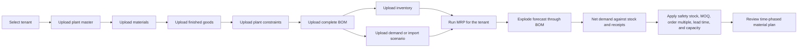

# Master Data: fields, domains, and MRP flow

This guide explains the Master Data page, what its fields mean, where the displayed records come from, and how the tenant CSV imports feed the MRP calculation.

## Important: the current page mixes sample UI and database uploads

The Master Data grid, the five domain lists, row counts, owner names, statuses, KPI cards, last-sync time, and data-quality percentage currently come from hard-coded demo data in `src/pages/master-data/index.tsx`. They are local browser state. They are not loaded from the selected tenant's database.

The **Upload CSV** control is a separate working path: it posts the selected CSV to the server, which writes supported records into the selected tenant's PostgreSQL schema. The current Master Data grid does not reload those database records after upload. Likewise, **Add**, **Edit record**, **Toggle status**, and **Export** act on the demo rows in the browser; they do not persist changes to tenant master tables. Therefore, do not use the displayed counts, status, data-quality score, or exported catalog as proof of what is in the database.

For actual database contents, use a successful upload confirmation and the MRP workflows that read tenant data, or query the selected tenant schema as an administrator. The demo values in the grid are illustrative only.

## What the page is for

Master data defines relatively stable planning reference information: which facilities exist, what is made, what materials are needed, and the policy for replenishing them. Demand and inventory change more often and are maintained in their own workflows. MRP combines the selected tenant's master data with forecasts and stock to calculate time-phased material requirements.

## Page controls and labels

| Screen field or control | Meaning and current behavior |
| --- | --- |
| Tenant selector in the top bar | Chooses the workspace. CSV imports are sent with the signed-in tenant context and written to that tenant's schema. Verify the tenant name before each upload. |
| **Export** | Downloads the currently filtered demo grid as a CSV. It is not a database export. |
| **Upload type** | Selects one supported database import: Plant master, Material master, Finished goods, Plant constraints, or Bill of materials. |
| **Upload CSV** | Sends the chosen CSV to `/api/import/csv`. The server validates required columns and references and uses the selected tenant schema. A successful message reports rows imported. |
| **Add [record]** | Opens a generic demo form. It updates only local page state; it is not a database create operation. The button label changes with the selected domain. |
| **Master records** | Demo count across all five local domain arrays. It is not a database count. |
| **Active records** | Demo count with status `Active`; not the count of active tenant master rows. |
| **Needs review** | Demo count with status `Review`; it does not validate uploaded tenant rows. |
| **Last sync** | Fixed demonstration value. It is not a live sync timestamp. |
| **Data domains** | The five navigation tabs described below. Counts beside each name are the local demo row counts. |
| **Search** | Filters the current demo grid by code, name, category, and planning notes. |
| **All statuses** | Filters demo rows by Active, Review, or Inactive. It does not activate/deactivate database records. |
| Table selection checkboxes | Visual selection controls in the demo table; no database bulk operation is connected. |
| **Actions** menu | Edit record, copy code, or toggle the demo row status. Edit and toggle are local-only; Copy code copies the displayed identifier. |
| Table footer / page buttons | Presentation controls in the sample UI. The displayed records are currently a small local list, not a database-paginated catalog. |
| Data quality percentage and guidance card | Demonstration indicator and explanatory text. The percentage is static, not calculated from the uploaded database data. |

### Table columns

- **Code**: the record's business identifier, such as a material code or plant code.
- **Name**: a readable description.
- **Category / Type**: the broad grouping, such as Raw, Packing, Bulk, or Bagged. Its exact meaning depends on the domain.
- **Unit**: unit of measure for materials/products. For Suppliers, Locations, and Planning Parameters, the demo UI repurposes this column to show a lead time, location, or value.
- **Planning attributes**: short descriptive notes in the demo grid. Real imports use explicit CSV columns, not this free-text summary.
- **Last updated**: illustrative timestamp in the demo grid.
- **Owner**: illustrative person/team label in the demo grid.
- **Status**: illustrative Active/Review/Inactive label in the demo grid. Database master upload handlers set imported plants, materials, and finished goods active; the grid does not reflect this.
- **Row actions**: local demo actions described above.

The **Add/Edit** form fields are generic: **Code** and **Name** are required; **Category / Type**, the domain-dependent fourth field, and **Planning attributes / Notes** are optional. Those generic inputs do not map to all of the database columns needed by the planner. Use the supported CSV formats below for MRP master data.

## The five Data domains

These are the five tabs shown in the left-side **Data domains** panel. They are UI groupings, not five database tables.

The sample page currently seeds these example codes and names directly in the frontend. They are not a feed from ERP, supplier systems, or the tenant database:

| Domain | Example demo rows shown in the page | Current source and actual use |
| --- | --- | --- |
| Materials | RM-0045 Aluminum Sheet; MT-0012 Motor Assembly; PK-3011 Packaging Box; SP-7781 Screw M6; RM-1120 Copper Wire; EL-2204 Control Relay | Hard-coded demo rows. Actual MRP material master comes from the Material master CSV upload. |
| Products & BOMs | PRD-1001 Control Panel; PRD-1002 Switch Assembly; PRD-1003 Power Module; PRD-1004 Enclosure Unit | Hard-coded demo rows. Actual finished goods and recipes come from Finished goods and Bill of materials CSV uploads. |
| Suppliers | SUP-001 ABC Suppliers; SUP-002 Global Traders; SUP-004 PackRight Solutions | Hard-coded demo rows. There is currently no supplier upload path in this screen. |
| Locations | LOC-001 Main Warehouse; LOC-002 Plant North; LOC-003 Plant Central | Hard-coded demo rows. Actual MRP facilities come from Plant master CSV upload. |
| Planning Parameters | PAR-001 Default service level; PAR-002 Planning time fence; PAR-003 Default calendar | Hard-coded demo rows. Actual MRP replenishment inputs come from Material master and Plant constraints CSV uploads. |

### 1. Materials

Materials are purchased or manufactured items that can appear as components in a product recipe. Examples include cement clinker, gypsum, packaging bags, or intermediate products. The domain helps MRP calculate component demand and replenishment.

The database-backed **Material master** CSV requires:

| CSV field | Meaning / use |
| --- | --- |
| `material_code` | Stable, unique item code within the tenant; referenced by BOM, inventory, and constraints. |
| `description` | Human-readable material name. |
| `category` | `Raw`, `Packing`, or `Intermediate`; used to classify and filter requirements. |
| `supply_type` | `BUY` for externally purchased items or `MAKE` for internally made intermediates. A MAKE material can have its own BOM. |
| `uom` | Stock and planning unit, such as ton, kg, or each. Quantities must be consistent with BOM usage. |
| `unit_cost` | Cost per unit; used for planned procurement value and spend reporting. |
| `scrap_pct` | Fraction of component loss, from 0 up to but not including 1. For example, `0.02` means 2% extra. |
| `lead_time_buckets` | Number of weekly or monthly planning buckets needed to replenish the item. The time unit follows the run's bucket type. |
| `moq` | Minimum order quantity. Suggested planned orders are raised to at least this amount when a net requirement exists. |
| `order_multiple` | Ordering increment. For example, a multiple of 100 means suggested order quantities round up in increments of 100. |
| `safety_stock_min` | Default minimum projected stock to protect against uncertainty. Plant-specific constraints can override the material default. |
| `max_capacity` | Default maximum stock/capacity; can be overridden by plant constraints. Used for capacity-exceeded alerts. |

### 2. Products & BOMs

This tab groups finished products and their bills of material conceptually. A **finished good** is the product whose forecast drives component demand. A **BOM** says how much of each component is needed for one unit of the parent product. MRP multiplies the product forecast by each BOM ratio and adds material scrap.

The real database import uses two CSV upload types:

**Finished goods** fields:

| CSV field | Meaning / use |
| --- | --- |
| `plant_code` | Facility where the product is planned or made. It must exist in Plant master. |
| `fg_code` | Finished-good identifier; used by forecast rows and BOM parent rows. |
| `description` | Product description. |
| `product_type` | `Bulk` or `Bagged`; supports product-type filtering. |
| `uom` | Forecast/output unit, such as ton. It must be coherent with demand and BOM ratios. |
| `active_flag` | `true` or `false`; only active finished goods are available for planning. |

**Bill of materials** fields:

| CSV field | Meaning / use |
| --- | --- |
| `plant_code` | Plant at which this product structure applies. |
| `fg_code` | Parent finished good. It must exist for the same plant. |
| `component_material_code` | Component material consumed by the parent. It must exist in Material master. |
| `quantity_per_fg` | Component quantity needed for one unit of the finished good. |
| `quantity_uom` | Unit for the component quantity; keep it consistent with the material's UOM. |
| `scrap_factor` | Optional source field for recipe loss. The current importer stores the ratio and the MRP calculation applies `scrap_pct` from Material master; it does not use this CSV field to calculate scrap. |

Upload finished goods before BOM. A BOM upload replaces the existing BOM component rows for each parent finished good included in that upload, then inserts the supplied rows. Upload a complete BOM file for each included parent; a partial file can remove omitted components for those parents.

### 3. Suppliers

Supplier data describes vendors, their contact and delivery attributes, and procurement performance. A future purchasing workflow can use it for supplier selection, lead-time comparison, purchase order defaults, and performance reporting.

The current Master Data tab shows demo supplier rows (for example, supplier code, name, category, lead time, location, rating, and review status). **There is no Supplier upload type or supplier database CRUD flow on this page today.** The generic Add/Edit and Export controls for this domain remain local demo behavior. Do not treat these rows as actual supplier records available to MRP or purchase orders.

### 4. Locations

Locations in the demo catalog represent warehouses and manufacturing sites. Actual MRP is scoped by **plant**. Use the real **Plant master** upload rather than the demo Locations tab.

Plant master fields:

| CSV field | Meaning / use |
| --- | --- |
| `plant_code` | Unique facility code, referenced by finished goods, BOM, inventory, constraints, and demand. |
| `plant_name` | Readable facility name. |
| `country_code` | Three-letter country code, used to filter the MRP run and identify currency. The code must be configured or supplied with supported country metadata. |
| `location` | City, region, or other descriptive site location. |
| `active_flag` | `true` or `false`; inactive plants are excluded from planning options. |

### 5. Planning Parameters

Planning parameters express replenishment policy. For the database-backed MRP, the relevant values are maintained through **Plant constraints** and Material master, rather than through the generic Planning Parameters demo tab.

Plant constraints fields:

| CSV field | Meaning / use |
| --- | --- |
| `plant_code` | Plant where this policy applies. |
| `material_code` | Material to which it applies. |
| `min_stock_qty` | Minimum projected stock target; the MRP engine uses this as the plant-level safety-stock target. |
| `reorder_level` | Reorder-point reference. It is stored as policy but is not currently used by the forward MRP netting formula. |
| `max_stock_qty` | Maximum allowed stock value. |
| `max_storage_capacity` | Storage limit; takes precedence for the capacity alert when supplied. |
| `lead_time_buckets` | Plant/material override for lead time. If absent, the material default is used. |
| `moq` | Plant/material override for minimum order quantity. |
| `order_multiple` | Plant/material override for order increment. |
| `uom` | Optional reference unit for the constraint values. |

The generic demo tab also displays examples such as service level, planning time fence, and calendar. These are **not currently uploaded or applied** by this forward MRP engine. In particular, a five-day calendar and a service level are not inferred from those local demo rows.

## Other upload data that is not a Master Data tab

Master data needs operational inputs to calculate a plan:

- **Inventory & stock** is uploaded from the Inventory page. It provides opening on-hand, reserved, in-transit quantity and due date, and scheduled receipts for each plant/material. These values determine supply available to cover the calculated need.
- **Demand forecast** is uploaded from Demand Planning as weekly/monthly CSV or imported as an Excel scenario workbook. It provides forecast quantity by plant, finished good, and period. A workbook scenario can retain customer dimensions such as Sold To and Ship To.
- **Scenario inputs** on Dashboard are run-specific overrides/filters. They do not replace master records.

## How the tenant database upload and MRP flow works

The recommended order is important because relationships are checked: a finished good refers to a plant; a BOM refers to a plant, finished good, and materials; inventory and constraints refer to a plant and material; demand refers to a plant and finished good. The database enforces these relationships within the tenant schema.

For each period, the engine first calculates component gross requirement:

`gross requirement = forecast quantity x BOM quantity per finished good x (1 + material scrap percentage)`

It then nets opening/projected stock and scheduled/in-transit receipts against gross requirement. The net requirement is the amount required to restore projected stock to the applicable safety-stock minimum. A positive requirement is rounded using the selected MOQ and order multiple, and release timing uses lead time. The engine flags projected stock above the selected capacity limit. Reorder level is stored but is not currently part of that forward calculation. Reserved stock is displayed in inventory but is not subtracted in the current forward MRP formula.

## Practical upload sequence

For a new empty tenant, use this sequence:

1. Select and verify the tenant in the top bar.
2. Master Data -> Plant master.
3. Master Data -> Material master.
4. Master Data -> Finished goods.
5. Master Data -> Plant constraints.
6. Master Data -> Bill of materials (upload complete component rows for each included parent).
7. Inventory -> Inventory & stock.
8. Demand Planning -> Monthly or Weekly demand forecast, or import a workbook scenario.
9. Dashboard -> select scenario, country, plant, horizon, bucket type, and start date; then run MRP.
10. Review the time-phased material plan, planned orders, release dates, expedite alerts, and capacity flags.

## Required column quick reference

Use the sample validation pack as ready-to-upload examples. Supported server-side CSV headers are:

- Plant master: `plant_code,plant_name,country_code,location,active_flag`
- Material master: `material_code,description,category,supply_type,uom,unit_cost,scrap_pct,lead_time_buckets,moq,order_multiple,safety_stock_min,max_capacity`
- Finished goods: `plant_code,fg_code,description,product_type,uom,active_flag`
- Plant constraints: `plant_code,material_code,min_stock_qty,reorder_level,max_stock_qty,max_storage_capacity,lead_time_buckets,moq,order_multiple`
- BOM: `plant_code,fg_code,component_material_code,quantity_per_fg` (optional source columns such as `quantity_uom` and `scrap_factor` may be included; only the component quantity is used by the current BOM importer/calculation)

See [the tenant validation guide](tenant_validation_guide.md) for the matching sample files, upload steps, and expected counts. See [the operational MRP guide](mrp_operational_workflow.md) for the end-to-end calculation and output notes.
