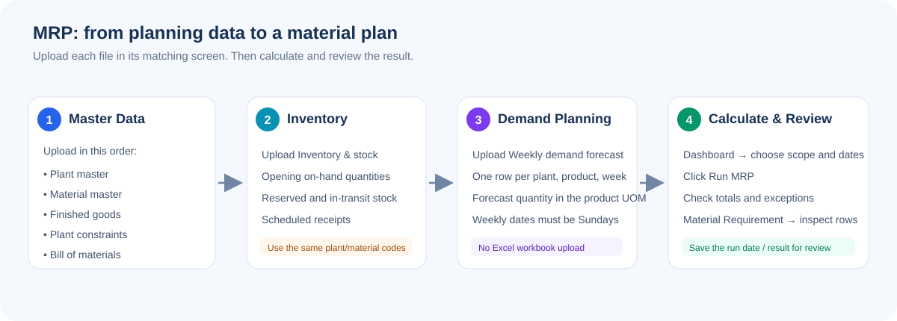
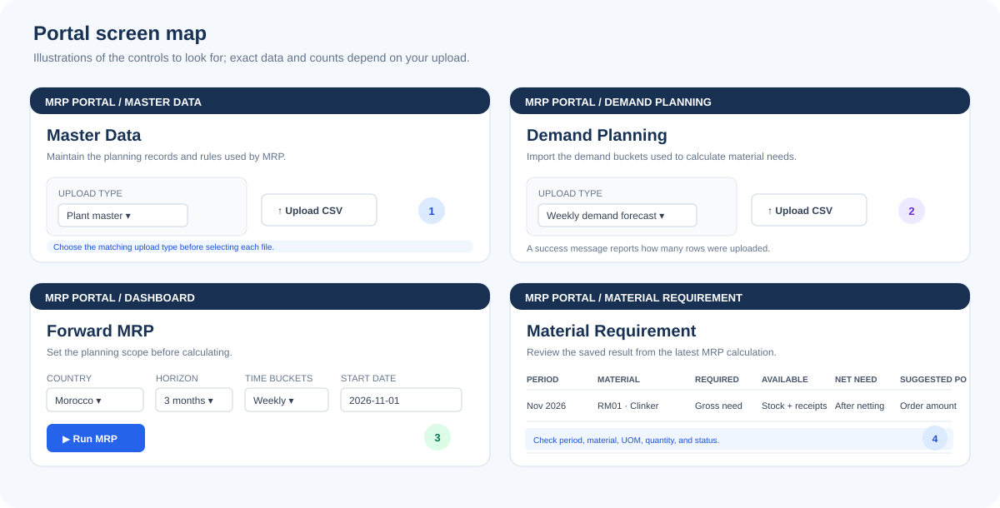

# MRP Portal: product owner guide

This guide explains how to load planning files, run the material plan, and check that the result looks sensible. It is written for the person using the portal; the upload files still need to follow the supplied CSV column headings.

For a one-page visual handout, open the [PDF version](mrp_product_owner_guide.pdf) or [SVG version](mrp_product_owner_guide.svg).

The screen pictures above are guide illustrations based on the portal's current controls. They are not live screenshots; the rows and quantities in your portal will depend on the data loaded.

## Before you start

- Ask the data owner for the latest approved CSV files. Do not use a previous forecast or stock file by habit; confirm the planning period and version first.
- The portal upload control accepts **CSV files only**, up to 10 MB. It does not accept the Excel workbook itself.
- The CSV column names are important. Keep the supplied header row unchanged, use comma-separated values, and use dates in `YYYY-MM-DD` format.
- All files in a planning run must use the same plant codes, product codes, material codes, units, and planning dates.
- The sample files in `database/sample-data/` are examples for training. They include inferred plant mappings and synthetic BOM, material, cost, stock, and constraint data. Get business approval before using them for a management or purchasing decision.

## Files to upload, in order

Use the Upload type menu to tell the portal what each file contains. Upload one file at a time and wait for the success message before moving on.

| Order | File in `database/sample-data/` | Choose this upload type | Upload from this screen | What it tells the planner |
|---:|---|---|---|---|
| 1 | [`plant_master.csv`](../database/sample-data/plant_master.csv) | Plant master | **Master Data** | Which plants are included and which country each plant belongs to |
| 2 | [`material_master.csv`](../database/sample-data/material_master.csv) | Material master | **Master Data** | Material names, units, cost, scrap, lead time, MOQ, and safety stock |
| 3 | [`fg_master.csv`](../database/sample-data/fg_master.csv) | Finished goods | **Master Data** | Products made at each plant, including bulk or bagged type |
| 4 | [`plant_constraints.csv`](../database/sample-data/plant_constraints.csv) | Plant constraints | **Master Data** | Plant-specific stock limits and purchasing rules; use when approved values exist |
| 5 | [`bom_input.csv`](../database/sample-data/bom_input.csv) | Bill of materials | **Master Data** | Materials and quantities used to make each finished product |
| 6 | [`inventory_input_with_dummy_dates.csv`](../database/sample-data/inventory_input_with_dummy_dates.csv) | Inventory & stock | **Inventory** | Upload-ready demo copy; includes placeholder due dates for all rows |
| 7 | [`demand_input.csv`](../database/sample-data/demand_input.csv) | Weekly demand forecast | **Demand Planning** | Forecast quantity by plant, product, and week |

The other two example files, [`demand_source_monthly.csv`](../database/sample-data/demand_source_monthly.csv) and [`demand_allocation_detail.csv`](../database/sample-data/demand_allocation_detail.csv), are for tracing and reconciling how weekly demand was derived. They are **not** upload files in the portal.

### Important when replacing or re-uploading files

- Load plant, material, and finished-good records before files that refer to them. Otherwise the portal cannot match the codes.
- Uploading master, inventory, or demand data updates matching records. The latest uploaded quantities will be used for the next calculation.
- A BOM upload replaces the component list for each plant/product pair present in that file. Make sure the file contains the complete BOM for every included pair before uploading it.
- The current demand uploader accepts weekly buckets only. Each `bucket_date` must be a Sunday. The example forecast starts on 1 November 2026; use your approved forecast dates when planning another period.
- For inventory, provide an in-transit due date when known. If `in_transit_qty` is positive but the date is blank, the MRP calculation assumes it arrives in the first planning bucket.
- The demo file uses `2026-11-08` as a placeholder date on rows with zero in-transit quantity so it also passes older deployed upload validation. These placeholder dates do not affect MRP calculations when the in-transit quantity is zero.
- A plant file currently needs a country code already supported by the portal importer. The supplied example uses Morocco (`MAR`, currency `MAD`). Ask the portal administrator to configure a new country before uploading another country.

## Run the forecast and material plan

The demand forecast is the expected quantity of finished products. **Run MRP** converts that forecast into material requirements using the BOM and then considers inventory and replenishment rules.

1. Open **Dashboard** from the left menu.
2. Choose the country for the plan. For the supplied example, choose **Morocco**.
3. Choose the plants to include. Leave all applicable plants selected if the plan is country-wide.
4. Choose the planning horizon, time bucket, and planning start date. These should match the approved forecast. For the supplied example data, use a start date of **1 November 2026**, **Weekly** buckets, and a **3-month** horizon.
5. Select **Run MRP** and wait for the completion message.
6. Review the dashboard totals, material rows, and any expedite or capacity alerts.
7. Open **Material Requirement** to review the saved result by period and material. Filter by period, product, material, status, or priority as needed.

An MRP run calculates and saves a material plan. It does not upload an Excel workbook or publish a new forecast for you. Check the forecast upload first, then run MRP after any change to forecast, BOM, stock, or purchasing rules.

## How to tell whether it worked

Use these checks after every run:

1. **Upload confirmation:** each upload shows a message such as “Weekly demand forecast: … rows uploaded.” If you see an error, fix that file before running MRP.
2. **Run confirmation:** the dashboard reports that MRP was calculated for a number of time buckets. The dashboard should then show totals and result rows rather than an empty result area.
3. **Coverage:** check that the selected plants and periods are represented. A forecasted product with no active BOM will not create the expected material rows.
4. **Reasonableness:** for one product and one material, check the calculation below. Use the same unit as the material's BOM line.
5. **Follow-up:** confirm that material shortages, suggested order quantities, and lead-time release dates make sense to the planner and procurement owner before acting on them.

### Simple calculation check

For a material in a bucket:

`Gross requirement = sum of (product forecast × BOM quantity per product) × (1 + scrap rate)`

Then:

`Net requirement = max(0, gross requirement + safety stock − available opening inventory − scheduled receipts)`

The plan checks buckets in date order, carrying projected stock forward. If the net requirement is greater than zero, the suggested order is at least the material's MOQ. The release date is shifted earlier by the material lead time. These are planning suggestions to review; compare the units and period dates before using them for purchasing.

### Example

If one product has a forecast of 100 tonnes, uses 0.5 tonnes of a material per tonne of product, and that material has 2% scrap:

- Gross requirement = 100 × 0.5 × 1.02 = **51 tonnes**.
- If opening inventory is 20 tonnes, scheduled receipts are 5 tonnes, and safety stock is 10 tonnes, net requirement = max(0, 51 + 10 − 20 − 5) = **36 tonnes**.
- If the MOQ is 40 tonnes, the suggested order is **40 tonnes**. Its release is moved earlier according to lead time.

## If something looks wrong

| What you see | What to check |
|---|---|
| Upload fails or reports a missing reference | Upload the plant/material/product master first. Check that all codes match exactly. |
| Upload reports missing columns | Use the correct upload type and approved template. Do not rename required headers. |
| Weekly forecast rejected | Confirm `bucket_type` is `Weekly` and each `bucket_date` is a Sunday in `YYYY-MM-DD` format. |
| Dashboard has no material results | Confirm a country/plant is selected, forecast rows fall within the chosen dates, and each forecasted product has an active BOM. |
| Requirement seems too high or low | Check forecast quantity, BOM quantity and unit, scrap rate, safety stock, opening stock, receipts, MOQ, and planning dates. |
| Existing values changed after upload | Re-uploaded matching records are updated. Confirm that the correct/latest file was selected. |
| Need to change plant, material, or product codes | Ask the data owner or portal administrator to update the related files together so the references continue to match. |

## What to send with a result for review

When sharing a result with the product owner or management, include the country, included plants, forecast version/source, planning start date, bucket type, horizon, and run date. Call out any missing forecast/BOM data, expedite alerts, capacity alerts, and materials where the suggested order is materially different from the net requirement because of MOQ.

The example demand files have blank actual quantities, so they cannot be used to judge forecast accuracy. Forecast accuracy needs actual demand loaded and compared with the forecast for the same products, plants, and periods.
